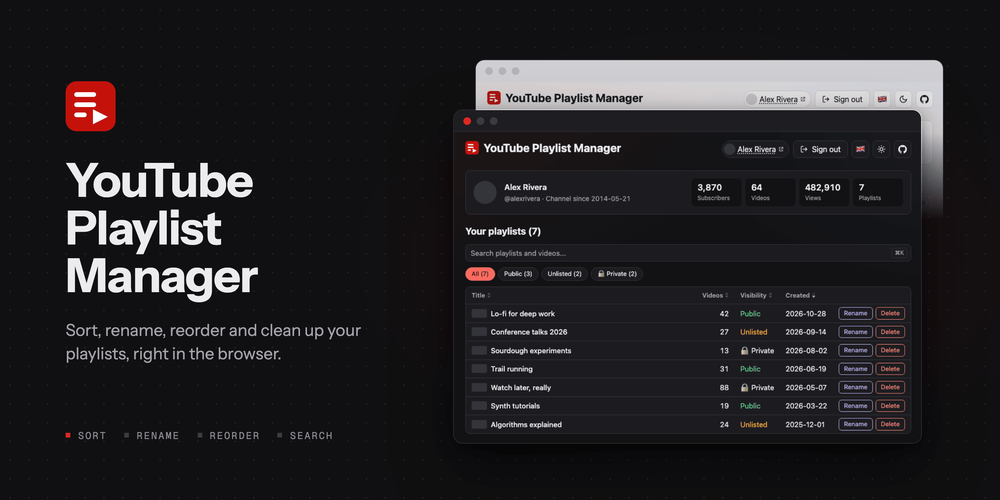
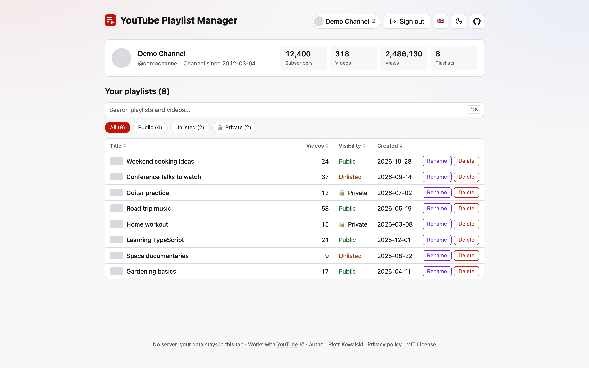

# YouTube Playlist Manager

<!-- prettier-ignore-start -->

<!-- prettier-ignore-end -->

🛠️ Browse, sort, rename and delete your YouTube playlists in one place.

**Live:** https://piecioshka.github.io/youtube-playlist-manager/

<picture>
  <source media="(prefers-color-scheme: dark)" srcset="docs/screenshots/playlists-dark.png">
  
</picture>

The hosted app only works for Google accounts added as test users of its OAuth client. To use it with your own account, deploy your own copy (see [CONTRIBUTING.md](CONTRIBUTING.md)).

## Features ✨

- 👤 Channel summary _(name, subscribers, videos, views)_
- 📋 Every playlist on your account in one list _(also beyond the first 50)_
- 🔤 Sort alphabetically or newest first _(your choice is remembered)_
- 🔎 Search playlists and the videos inside them _(Cmd+K / Ctrl+K)_
- ✏️ Rename a playlist inline _(the description stays untouched)_
- 🗑️ Delete a playlist after an inline confirmation
- 🗂️ Playlist page _(edit description and visibility, reorder videos by drag and drop, remove and add videos, clean out deleted and private ones)_
- 🌗 System, light and dark theme _(follows your system until you pick one, your choice is remembered)_
- 📱 Works on a phone _(tables turn into cards, videos reorder under a finger)_
- ♿ Keyboard and screen reader friendly _(checked with axe in both themes)_
- 🌍 Polish and English interface _(Polish by default)_
- 🔒 No backend _(the access token stays in the current browser tab only, and a content security policy admits only Google sign-in and the YouTube API)_

## Contributing 🤝

Setup, Google Cloud configuration, scripts and architecture: [CONTRIBUTING.md](CONTRIBUTING.md).

## License 📄

[The MIT License](https://piecioshka.mit-license.org) @ 2026
